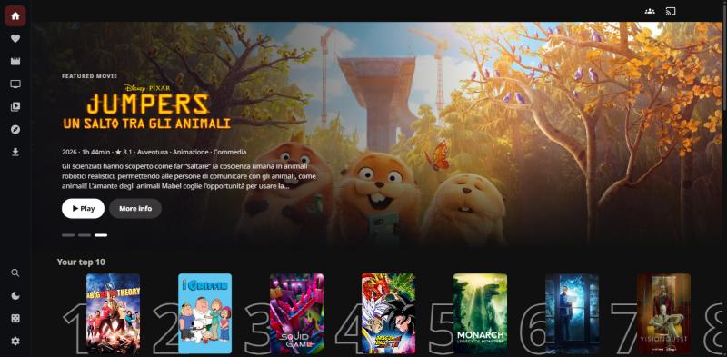
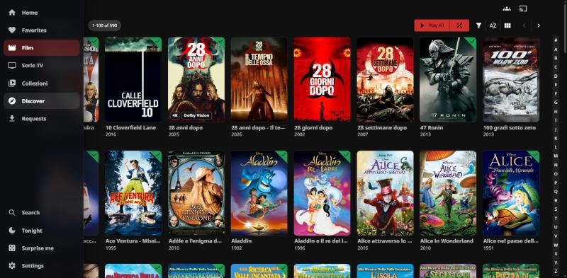
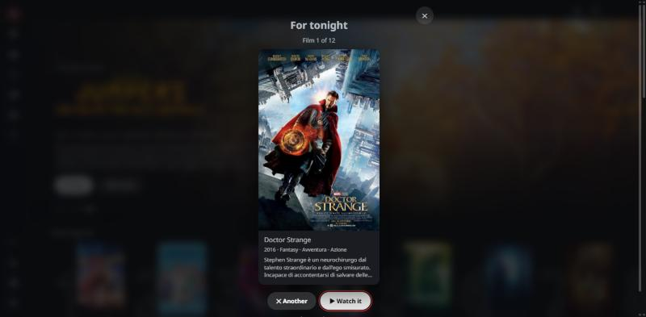

# Afterglow (plugin) for Jellyfin

The extras of the [Afterglow theme](https://github.com/kiketorres98/jellyfin-afterglow): small features for the Jellyfin web client that CSS alone cannot do.
Theme and plugin are separate on purpose: use the theme alone, or add the plugin.

## What it does

| Home: billboard and top 10 | Side menu and quality marks | Tonight |
|---|---|---|
|  |  |  |

| Feature | What you see |
|---|---|
| **Quality marks** | Small `4K`, `2K`, `HDR` and `Dolby Vision` marks on posters and list rows. Ordinary 1080p gets none, so the marks mean something. |
| **Side menu** | The sections (home, favorites, your libraries, plus Discover/Requests if that plugin is installed) as a narrow rail of icons that opens when you point at it. Desktop layout only; it steps aside in the dashboard, the player and the sign-in pages. |
| **Home billboard** | Three featured titles a day (unwatched first) with logo, facts, plot, Play and More info. The whole page takes the colours of the title on show. Replaces the Media Bar plugin's slideshow. |
| **Top 10** | A shelf of the titles *you* watched most; episodes count for their series. Hidden until you have watched at least three titles. |
| **Tonight** | "What shall we watch?": pick a mood and a length, then swipe through unwatched films. |
| **Empty favorites** | A friendly message instead of a blank page. |

Each feature can be switched off in the plugin's settings, where you can also choose where the top 10 goes (under the billboard, after "Continue watching", or at the bottom) and which corner of the posters the quality marks use. On phones and TVs the web client's own menu gets a "Tonight" entry, and entries another plugin added twice are shown once. Playback always uses Jellyfin's own player.

## Install

1. **File Transformation** must be installed first (Afterglow uses it to add its script to the web client).
   Dashboard → Plugins → Repositories → add `https://www.iamparadox.dev/jellyfin/plugins/manifest.json`, then install **File Transformation** from the Catalogue.
2. Add the Afterglow repository: Dashboard → Plugins → Repositories → **+**
   `https://raw.githubusercontent.com/kiketorres98/jellyfin-plugin-afterglow/main/manifest.json`
3. Catalogue → **Afterglow** → Install.
4. **Restart Jellyfin**, then reload the web page (Ctrl+F5).

Settings: Dashboard → Plugins → Afterglow.

## Compatibility

- Built for **Jellyfin 12.3.x**: the version number says so (12.3.0.0 is the first release for Jellyfin 12.3.0; a fix for the same server version becomes 12.3.0.1). A plugin is tied to the server version it was built for: after a Jellyfin upgrade it may show as "not supported" until a new release comes out.
- Works with the dark theme or with any other theme (the marks bring their own tiny style).

## If nothing shows up

- Check the Jellyfin log for `Afterglow:` lines. "script registered" means all is well; "File Transformation plugin was not found" means step 1 is missing.
- Open `https://YOUR-SERVER/Afterglow/afterglow.js`: you should see the script.

## For developers

```
dotnet test tests/Jellyfin.Plugin.Afterglow.Tests      # C# tests
node --test tests/*.test.mjs                           # script and manifest tests
node scripts/release.mjs 12.3.0.1 "What changed"        # build, pack and update manifest.json (the CI does this on a tag)
```

To publish a version: `git tag v12.3.0.1 && git push --tags`. The workflow tests, packs, creates the GitHub release and updates `manifest.json`.

## License

GPL-3.0, like the Jellyfin libraries it builds on.
